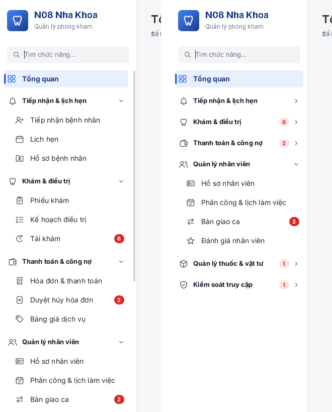

# Menu Admin — N08 Nha Khoa

Menu dọc bên trái cho tài khoản Quản trị: **21 màn hình**, chia **6 nhóm nghiệp vụ** có thể xổ xuống / thu gọn,
icon bên trái từng mục, badge việc chờ xử lý, ô tìm chức năng.



## Cấu trúc menu (theo luồng nghiệp vụ)

| Nhóm | Mục | Use case |
|---|---|---|
| — | Tổng quan | QL-01 |
| Tiếp nhận & lịch hẹn | Tiếp nhận bệnh nhân · Lịch hẹn · Hồ sơ bệnh nhân | UC01–03, 06–09, 23 |
| Khám & điều trị | Phiếu khám · Kế hoạch điều trị · Tái khám | UC10–16 |
| Thanh toán & công nợ | Hóa đơn & thanh toán · Duyệt hủy hóa đơn · Bảng giá dịch vụ | UC04, UC05 |
| Quản lý nhân viên | Hồ sơ nhân viên · Phân công & lịch làm việc · Bàn giao ca · Đánh giá nhân viên | UC17–20, 22, 24–26 |
| Quản lý thuốc & vật tư | Thuốc & vật tư · Nhập / xuất / hoàn trả · Kiểm kê & hao hụt · Hộp cấp cứu · Nhà cung cấp | UC27–37 |
| Kiểm soát truy cập | Tài khoản & phân quyền · Nhật ký thao tác | UC21 |

## File

```
src/com/quanlynhakhoa/desktop/menu/
  AdminMenu.java      — định nghĩa nhóm / mục / khóa màn hình (sửa menu ở đây)
  MenuIcon.java       — icon vẽ bằng Java2D, không cần file ảnh
  SidebarMenu.java    — component menu
  AdminMenuDemo.java  — chạy thử độc lập
```

Chép thư mục `menu` vào `src/main/java/com/quanlynhakhoa/desktop/`.

## Gắn vào MainFrame

```java
CardLayout cards = new CardLayout();
JPanel content = new JPanel(cards);
content.add(tongQuanPanel, AdminMenu.TONG_QUAN);
content.add(lichHenPanel,  AdminMenu.LICH_HEN);
// ... mỗi màn hình một card, tên card = khóa trong AdminMenu

SidebarMenu menu = new SidebarMenu("N08 Nha Khoa", "Quản lý phòng khám",
        null,                       // hoặc Image logo của phòng khám
        AdminMenu.home(), AdminMenu.groups());
menu.addSelectionListener(key -> cards.show(content, key));
menu.select(AdminMenu.TONG_QUAN);

frame.add(menu, BorderLayout.WEST);
frame.add(content, BorderLayout.CENTER);
```

## API

| Phương thức | Tác dụng |
|---|---|
| `select(key)` | Chọn mục, tự mở nhóm chứa nó, phát sự kiện (dùng cho link "Việc cần xử lý" ở Tổng quan) |
| `setBadge(key, n)` | Số việc chờ; nhóm thu gọn hiện tổng badge màu nhạt |
| `setEntryVisible(key, false)` | Ẩn mục theo quyền — nhóm hết mục tự ẩn |
| `setAccordion(true)` | Chỉ mở một nhóm tại một thời điểm |
| `expandAll()` / `collapseAll()` / `setGroupExpanded(groupKey, b)` | Điều khiển nhóm |

## Ảnh / icon bên trái

- Mặc định: icon vector trong `MenuIcon` (đổi màu theo trạng thái chọn).
- Dùng ảnh riêng: đặt `src/main/resources/images/menu/<key>.png` (ví dụ `lich-hen.png`) — tự động thay icon vẽ, scale 18×18.
- Logo: truyền `Image` vào tham số thứ ba của `SidebarMenu`.

## Thao tác

- Bấm tiêu đề nhóm để xổ xuống / thu gọn (có hiệu ứng 180 ms).
- Ô tìm kiếm bỏ dấu, tìm cả mã use case: `cong no`, `uc14`, `kho`. `Esc` để xóa.
- Bàn phím: `Tab` / `↑` `↓` di chuyển, `Enter` / `Space` chọn hoặc mở nhóm.

## Chạy thử

```powershell
javac -encoding UTF-8 -d out src\com\quanlynhakhoa\desktop\menu\*.java
java -cp out com.quanlynhakhoa.desktop.menu.AdminMenuDemo
```

## Màn hình Tổng quan + khung chính (Swing)

```
src/com/quanlynhakhoa/desktop/admin/
  AdminMainFrame.java — JFrame: menu trái + thanh trên + CardLayout
  TongQuanPanel.java  — màn hình Tổng quan (thẻ chỉ số, bảng việc cần xử lý, lịch hẹn, thu tiền)
  Ui.java             — màu, font, nút, định dạng JTable dùng chung
```

Chạy: `java -cp out com.quanlynhakhoa.desktop.admin.AdminMainFrame` — ảnh: `tong-quan-swing.png`.
Số liệu trong `TongQuanPanel.reload()` là dữ liệu mẫu, cần nối `TongQuanService`.
